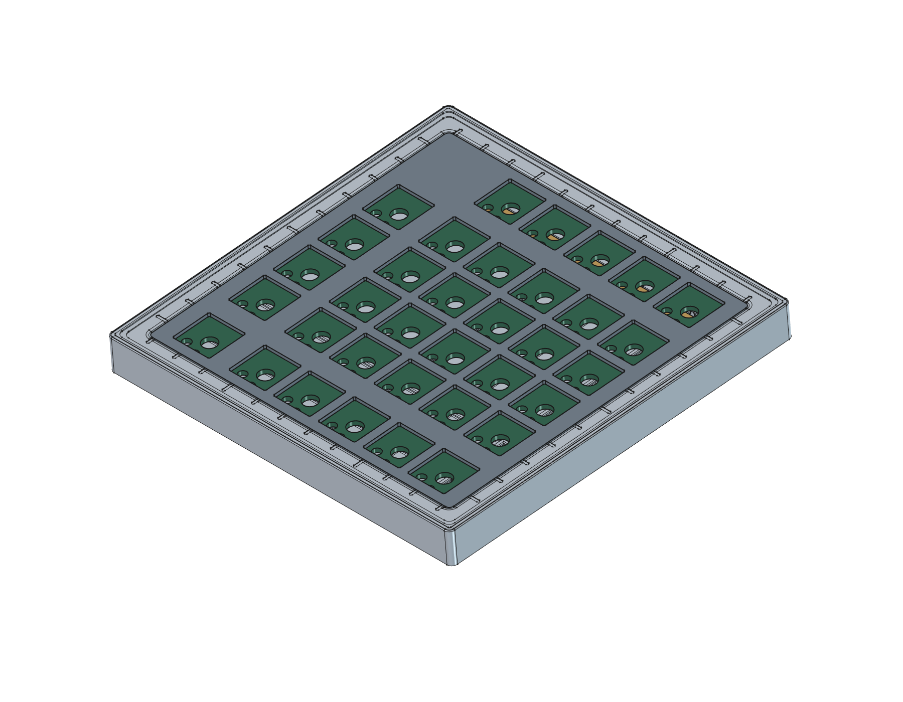

# 段付き額縁・地図目盛りの外観検討案

開くファイル：[`minimap_frame.FCStd`](minimap_frame.FCStd)。現行の `../../minimap.FCStd` から分けた比較用モデルであり、現行ケースの置き換えではない。

## 意匠と寸法

| 項目 | 現行 | 前の額縁案 | 調整後 |
| --- | --- | --- | --- |
| 壁厚（直線部の基本寸法） | 2.5mm | 4.5mm | 7.5mm |
| 外寸 | 120.5mm角 | 124.5mm角 | 130.5mm角 |
| 外周の平面角R | R4.5 | R2.0 | R2.0 |
| 外周上面高さ | Z11.6mm | Z11.6mm | Z12.4mm |
| 基本底厚 | 2.5mm | 2.5mm | 2.5mm（下面外周の逃げ部分を除く） |
| 基本内寸・内側角R | 115.5mm角・R2 | 維持 | 維持 |

上面は、外側から内側へ下がる三段の額縁とした。

| 段 | 直線部の幅 | 上面Z |
| --- | --- | --- |
| 外周の縁 | 2.0mm | 12.4mm |
| 中間の肩 | 1.25mm | 12.05mm |
| 目盛りを置く内側の段 | 3.5mm | 11.75mm |

内周は幅0.75mm・深さ0.15mmの斜面で、既存プレート上面Z11.6mmへ下げる。外周の飾り溝は幅1.0mm・深さ0.18mm、外周から0.5mm内側とした。飾り溝の平面角Rは外側R1.5・内側R0.5。平面外形の角R2、外周の小面R0.3は維持。

目盛りの溝は前案の92本から正確に半分の **46本**へ減らした。前後（設計座標±Y）各12本、左右（±X）各11本で、向かい合う辺と各辺の中心に対する対称性を保つ。間隔10mm。旧目盛りを交互に残しており、長い線は各辺で50mm間隔、隣の辺とは位相が25mm異なる。四隅は線を置かず余白とした。

目盛り溝は **幅1.0mm・止まり側の平面R0.5・深さ0.2mm**。短線・長線の外側端位置は維持し、内側だけケース開口まで延長した。内周の斜面を横切って開口へ抜ける、底付きの開放溝であり、ケース底まで貫通する穴ではない。スケッチ上は両端R0.5のカプセル形状で、内側端は空洞内へ逃がしている。地図の枠目盛りを意図した装飾であり、校正された測定器ではない。

目盛りと外周飾り溝は、公称φ1mmのフラットエンドミルを想定した幅・平面Rとした。目盛りの止まり側に直角の内角を残さず、内側は開放する。これは形状上の工具径想定であり、CAM作成や実加工可否の承認ではない。

`VarSet` の `Picture frame` グループが意匠寸法。主なフィーチャーは `FrameOuterStep`・`FrameScaleStep`・`FrameInnerBevel`・`FrameHairlineGroove`・`MapGraduationEngraving`。目盛りは一つの完全拘束スケッチからPocketで彫る。各寸法には成立範囲があり、任意の組み合わせへの変更を保証するものではない。目盛り本数と長線の配置を変える場合はスケッチの再構成が必要。

基板・プレート、四点の基板固定、ウェイト二案、ゴム参考形状、傾斜5°は維持した。側壁の増厚に合わせUSBポケットの開始位置と内側ポケット深さは既存の式で追従する。USB外側ポケットの深さ1.5mmは変えていないため、外面からコネクターまでの距離は増える。

幅を増した前端が公称机面へ接触するのを避けるため、下面外周の幅3mmに深さ0.35mmの逃げを追加した（`FrameBottomEdgeRelief`）。この部分の底厚は基本値から0.35mm減る。固定部やゴムを動かさず、公称の硬いケース最低隙間約0.227mmを確保している。

## 出力と確認

- [`minimap_frame_case.step`](minimap_frame_case.step)：この案のケースだけ。ケースの設計座標系であり、傾斜した組立姿勢ではない。現行の `../../STEP/` は変更していない。
- [`geometry-check.json`](geometry-check.json)：保存済みCADの幾何検査結果。
- [`preview.png`](preview.png)：基板・プレート参考形状付きの斜視図。
- [`preview-top.png`](preview-top.png)：段の輪郭と目盛りを見る上面図。

ケースは有効な単一ソリッド。全36スケッチが完全拘束、Block拘束0、無効オブジェクト0。固定軸周囲・参考部品との関係、段の高さ、彫り深さ、目盛り端Rと内周への開放、STEP再読込の照合結果は `geometry-check.json` に記録する。

前の壁厚4.5mm案とその出力は、`../../../archive/Case/picture-frame-before-map-20261106/` に控えを保存した。現行CADと現行STEPには変更していない。

CNC向け溝調整前の92本案とその出力は、`../../../archive/Case/map-frame-before-cnc-20261106/` に保存した。

## 未確認事項

**外観検討用・製造未承認。** USB開口上を外周溝が通る箇所の公称残肉は **1.535mm**（前の額縁案では0.715mm）。外周上面を0.8mm上げ、溝を0.18mmとした結果であり、強度を認定するものではない。増厚後の実USBプラグの挿入性、ケーブルとの干渉、薄肉部の強度は未確認。

φ1mm工具による浅い溝加工について、材質、工具の実径・振れ、底刃のコーナーR、切削条件、CAM、保持方法、工具の接近性、バリ処理、寸法公差は加工先で確認が必要。ケース全体のCNC加工適合を保証するものではない。3DPでの再現性も別途確認する。実物のゴム圧縮や机面の不整による接触、上面を高くした枠と実キーキャップの可動時干渉も未確認。

U3の部品モデル欠落、スイッチ／プレート着座高さ、実金具、公差、強度、転倒安定性など、[現行ケースの未確認事項](../../../doc/case.md)も継続する。`production_ready=false`。
